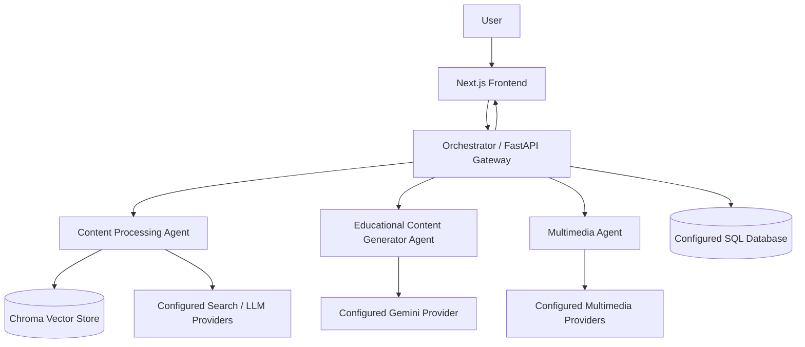

# Educational Content Generator AI Agent

An AI-powered educational platform built with a modular multi-agent architecture. It brings together educational question answering, content processing and retrieval, quiz and flashcard generation, and multimedia capabilities in one application.

> **Project demo:** [Watch the demo on Google Drive](https://drive.google.com/file/d/1pLrF9Z-IYn_o2_5okTmI8qRvqVtArvLn/view?usp=drive_link)

## Table of contents

- [Overview](#overview)
- [Key capabilities](#key-capabilities)
- [Architecture](#architecture)
- [Technology stack](#technology-stack)
- [Repository structure](#repository-structure)
- [Getting started](#getting-started)
- [Environment configuration](#environment-configuration)
- [Service endpoints](#service-endpoints)
- [API documentation](#api-documentation)
- [Testing](#testing)
- [Deployment notes](#deployment-notes)
- [Known limitations](#known-limitations)
- [Contributing](#contributing)
- [License](#license)

## Overview

The application is organized as a Next.js frontend and several Python/FastAPI services. The Orchestrator acts as the API gateway and coordinates requests across specialized services.

### Specialized services

| Component | Responsibility |
|---|---|
| **Orchestrator Agent** | Gateway endpoints, authentication, chat/session handling, workflow coordination, quiz/flashcard/report routes, and communication with backend agents |
| **Content Processing Agent** | Content ingestion, document processing, OCR/loaders, text chunking, embeddings, vector retrieval, search, and question processing |
| **Educational Content Generator Agent** | Educational chat, quiz generation, and flashcard generation |
| **Multimedia Agent** | Multimedia endpoints for summaries, text-to-speech, speech-to-text, image/video operations, and diagram generation where configured |
| **Frontend** | Next.js user interface for interacting with the platform |

## Key capabilities

The repository contains implementation modules for:

- Educational question answering and chat.
- Content ingestion, parsing, chunking, and retrieval.
- Subject detection and question processing.
- Quiz generation and quiz retrieval.
- Flashcard generation.
- Chat sessions, authentication, and learning analytics/report endpoints.
- Multimedia operations including TTS, STT, image, and video routes.
- Programmatic educational diagram generation in the Multimedia Agent.

Availability of external-provider features depends on valid API credentials, provider quotas, and deployment configuration. Check the [known limitations](#known-limitations) before presenting a feature as operational.

## Architecture



The Orchestrator is the central entry point for the frontend. The individual services expose their own FastAPI routes and communicate through HTTP service URLs configured with environment variables.

See [docs/ARCHITECTURE.md](docs/ARCHITECTURE.md) for more detail.

## Technology stack

| Area | Technologies found in the repository |
|---|---|
| Frontend | Next.js, React, TypeScript |
| Backend APIs | Python, FastAPI, Uvicorn |
| Agent workflows | LangChain, LangGraph (where configured in service code) |
| LLM integrations | Google Gemini and Groq integrations are present in the codebase |
| Retrieval | ChromaDB, embeddings, retrieval services |
| Document processing | PDF/Office loaders, OCR, Pillow and related processing libraries |
| Database | SQLAlchemy; database connection configured through `DATABASE_URL` |
| External services | Tavily and other provider integrations, depending on configuration |

## Repository structure

```text
.
├── Content-Processing-Agent/
│   ├── app/
│   │   ├── analyzers/       # Document analysis
│   │   ├── api/             # Upload, search, retrieval, quiz routes
│   │   ├── chunkers/        # Text chunking
│   │   ├── database/        # Chroma clients and database helpers
│   │   ├── embeddings/      # Embedding model integration
│   │   ├── knowledge/       # Knowledge loading/indexing
│   │   ├── loaders/         # PDF, Office and text loaders
│   │   ├── ocr/             # OCR components
│   │   └── services/        # Processing, RAG, retrieval and search services
│   ├── main.py
│   └── requirements.txt
├── Educational-Content-Generator-Agent/
│   └── backend/
│       ├── api/             # Chat, upload and flashcard routes
│       ├── quiz/            # Quiz routes and services
│       ├── prompts/
│       ├── services/
│       └── main.py
├── Multimedia-Agent/
│   └── backend/
│       ├── api/
│       ├── services/
│       └── main.py
├── Orchestrator_Agent/
│   ├── api/                 # Gateway API routes
│   ├── graph/               # Workflow graph
│   ├── routing/             # Intent/workflow routing
│   ├── database/
│   ├── services/
│   ├── tests/
│   └── main.py
├── frontend/
│   ├── app/
│   ├── components/
│   └── package.json
└── docs/
```

## Getting started

### Prerequisites

- Python version compatible with each service's requirements. The Content Processing Agent includes a `.python-version` file specifying Python 3.13.
- Node.js and npm compatible with the frontend's Next.js version.
- A SQL database supported by the configured SQLAlchemy connection (if using the Orchestrator's database-backed features).
- API credentials for the providers you intend to use.

> Each Python service has its own dependency file. Use a separate virtual environment for each service to avoid dependency conflicts.

### 1. Clone the repository

```bash
git clone https://github.com/tanishka0510/Educational-Content-Generator-AI-Agent.git
cd Educational-Content-Generator-AI-Agent
```

### 2. Configure environment variables

Create local `.env` files in the relevant service directories. Use the variable names listed in [`.env.example`](.env.example) as a reference. Never commit real API keys, passwords, database credentials, or JWT secrets.

### 3. Install and run the Orchestrator

```bash
cd Orchestrator_Agent
python -m venv .venv
# Windows PowerShell:
.venv\Scripts\Activate.ps1
# macOS/Linux:
# source .venv/bin/activate
pip install -r requirements.txt
uvicorn main:app --host 0.0.0.0 --port 8000 --reload
```

### 4. Install and run the Content Processing Agent

Open a new terminal:

```bash
cd Content-Processing-Agent
python -m venv .venv
# Windows PowerShell:
.venv\Scripts\Activate.ps1
pip install -r requirements.txt
uvicorn main:app --host 0.0.0.0 --port 8001 --reload
```

### 5. Install and run the Educational Agent

Open a new terminal:

```bash
cd Educational-Content-Generator-Agent/backend
python -m venv .venv
# Windows PowerShell:
.venv\Scripts\Activate.ps1
pip install -r requirements.txt
uvicorn main:app --host 0.0.0.0 --port 8002 --reload
```

### 6. Install and run the Multimedia Agent

Open a new terminal:

```bash
cd Multimedia-Agent
python -m venv .venv
# Windows PowerShell:
.venv\Scripts\Activate.ps1
pip install -r backend/requirements.txt
uvicorn backend.main:app --host 0.0.0.0 --port 8003 --reload
```

### 7. Run the frontend

Open another terminal:

```bash
cd frontend
npm install
npm run dev
```

Open `http://localhost:3000`.

### Local service map

| Service | Local URL | API docs |
|---|---|---|
| Frontend | http://localhost:3000 | — |
| Orchestrator | http://localhost:8000 | http://localhost:8000/docs |
| Content Processing | http://localhost:8001 | http://localhost:8001/docs |
| Educational Agent | http://localhost:8002 | http://localhost:8002/docs |
| Multimedia Agent | http://localhost:8003 | http://localhost:8003/docs |

Run each command from the directory shown. The service URLs and ports must agree with the environment variables used by the other services.

## Environment configuration

See [`.env.example`](.env.example) for a starter list of variable names discovered in the source. Values are intentionally blank. Some variables are optional and only needed when their corresponding feature is enabled.

Important service URL variables include:

- `NEXT_PUBLIC_API_URL` – frontend API base URL.
- `NEXT_PUBLIC_MULTIMEDIA_URL` – frontend multimedia service URL.
- `CONTENT_PROCESSING_URL` / `CONTENT_PROCESSING_AGENT_URL` – Content Processing service URL, depending on the caller.
- `EDUCATIONAL_AGENT_URL` – Educational Agent URL.
- `MULTIMEDIA_AGENT_URL` – Multimedia Agent URL.
- `DATABASE_URL` – Orchestrator database connection.
- `JWT_SECRET_KEY` – secret used for authentication token signing.

Do not expose secret values in frontend variables prefixed with `NEXT_PUBLIC_`.

## Service endpoints

The routes below are derived from the FastAPI route declarations in this repository. Some routers have prefixes, so the full paths are shown where identifiable.

### Orchestrator (port 8000)

| Method | Route | Purpose |
|---|---|---|
| GET | `/` | Gateway status |
| POST | `/signup` | Register account |
| POST | `/login` | Authenticate |
| GET | `/me` | Current user |
| POST | `/process-content` | Process a chat/content request |
| POST | `/chats/session` | Create chat session |
| GET | `/chats` | List chat sessions |
| GET | `/chats/{session_id}` | Get chat session |
| PATCH | `/chats/{session_id}` | Update chat session |
| DELETE | `/chats/{session_id}` | Delete chat session |
| POST | `/quiz/generate` | Generate quiz |
| POST | `/quiz/submit` | Submit quiz |
| GET | `/quiz/history` | Quiz history |
| POST | `/flashcards/generate` | Generate flashcards |
| POST | `/flashcards/submit` | Submit flashcard activity |
| GET | `/analytics` | Analytics |
| GET | `/study-plan` | Study plan |
| POST | `/qa` | Voice/question-answer route |

### Content Processing Agent (port 8001)

| Method | Route | Purpose |
|---|---|---|
| GET | `/` | Service status |
| GET | `/health` | Health check |
| GET | `/detect-subject` | Detect subject from a question |
| POST | `/ask` | Ask a question |
| POST | `/process-content` | Process a question/content request |
| POST | `/upload/` | Upload content |
| POST | `/quiz/retrieve` | Retrieve quiz questions |

### Educational Agent (port 8002)

| Method | Route | Purpose |
|---|---|---|
| GET | `/` | Service status |
| POST | `/chat` | Educational chat |
| POST | `/upload` | Upload route |
| POST | `/generate` | Quiz generation (confirm router prefix/schema in Swagger) |
| POST | `/generate` | Flashcard generation (router prefix/schema in Swagger) |

### Multimedia Agent (port 8003)

| Method | Route | Purpose |
|---|---|---|
| GET | `/` | Service status |
| GET | `/health` | Health check |
| POST | `/multimedia/summary` | Summary operation |
| POST | `/multimedia/tts` | Text-to-speech |
| POST | `/multimedia/stt` | Speech-to-text |
| POST | `/multimedia/ask` | Multimedia question operation |
| POST | `/multimedia/image` | Image generation |
| POST | `/multimedia/video` | Video operation |
| POST | `/multimedia/process` | Multimedia processing |

For exact request schemas, response models, and interactive testing, start the relevant service and open its `/docs` page.

## API documentation

- [Architecture](docs/ARCHITECTURE.md)
- [API reference](docs/API.md)
- [Local setup and deployment](docs/SETUP.md)

FastAPI's Swagger UI is the authoritative source for the live request/response schemas.

## Testing

Tests are present in the Content Processing Agent and Orchestrator directories. Run tests from the corresponding service directory after installing its dependencies:

```bash
# Content Processing Agent
cd Content-Processing-Agent
pytest

# Orchestrator
cd Orchestrator_Agent
pytest
```

The repository also contains individual test scripts. Review each script before running it because some may call external APIs or require credentials.

## Deployment notes

The repository contains separate services, so deploy each backend as an independent web service and deploy the Next.js frontend separately. Configure each service's start command, environment variables, allowed CORS origins, and service-to-service URLs in the hosting provider.

Typical backend start commands:

```bash
# Orchestrator
uvicorn main:app --host 0.0.0.0 --port $PORT

# Content Processing Agent
uvicorn main:app --host 0.0.0.0 --port $PORT

# Educational Agent (set the service root to Educational-Content-Generator-Agent/backend)
uvicorn main:app --host 0.0.0.0 --port $PORT

# Multimedia Agent (run from Multimedia-Agent)
uvicorn backend.main:app --host 0.0.0.0 --port $PORT
```

Do not copy local `localhost` URLs into production environment variables. Use the deployed service URLs.

## Known limitations

- External AI, search, speech, and image/video operations depend on provider availability, credentials, quotas, and network access.
- The presence of an API route does not by itself guarantee that its provider integration is currently operational.
- Verify each feature end-to-end in the deployed environment before describing it as available to users.
- Document upload and processing flows should be tested with the current request schema and downstream service configuration before being advertised as production-ready.
- The repository has multiple independent Python dependency sets; a clean environment install should be validated for each service.

## Contributing

See [CONTRIBUTING.md](CONTRIBUTING.md) for development and pull request guidelines.

## License

No license file was present in the supplied project archive. Add a license only after deciding how you want others to use, modify, and distribute this project.
