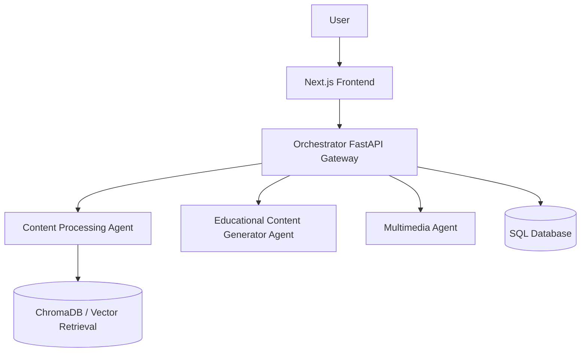

# Architecture

## High-level design

The system consists of a Next.js frontend, an Orchestrator API gateway, and three specialized FastAPI services.

## Components

### Frontend
The `frontend/` directory contains the Next.js application and React components. It reads its public API base URLs from environment variables such as `NEXT_PUBLIC_API_URL` and `NEXT_PUBLIC_MULTIMEDIA_URL`.

### Orchestrator Agent
`Orchestrator_Agent/main.py` creates the FastAPI gateway, configures CORS, initializes SQLAlchemy metadata, and registers authentication, chat, upload, quiz, flashcard, report, and voice routers. Workflow logic is organized into `graph/`, `routing/`, `services/`, and `agent.py`.

### Content Processing Agent
`Content-Processing-Agent/main.py` registers upload, search, retrieval, and quiz routes. The `app/` package contains loaders, OCR, preprocessing, chunking, embedding, Chroma clients, knowledge indexing, subject detection, and RAG/retrieval services.

### Educational Content Generator Agent
`Educational-Content-Generator-Agent/backend/main.py` registers chat, upload, quiz, and flashcard routers. Its services and prompt modules support educational content generation.

### Multimedia Agent
`Multimedia-Agent/backend/main.py` registers the multimedia router and serves generated output files from `/outputs`. The multimedia API module declares summary, TTS, STT, ask, image, video, and process routes. The backend services contain the implementation details for the configured providers and diagram renderer.

## Request flow

1. The frontend sends a request to the Orchestrator gateway.
2. The gateway endpoint and workflow logic determine which specialized service is required.
3. The Orchestrator calls the configured service URL over HTTP.
4. The specialized service processes the request and returns a response.
5. The Orchestrator returns the response to the frontend.

Not every workflow necessarily invokes every agent. Actual routing depends on the request type and the implementation in the corresponding workflow/API module.

## Local ports

| Service | Default port |
|---|---:|
| Orchestrator | 8000 |
| Content Processing | 8001 |
| Educational Agent | 8002 |
| Multimedia Agent | 8003 |
| Frontend | 3000 |

## Configuration

The service URLs must point to reachable services. In production, use deployed internal/public service URLs rather than localhost. CORS origins must include the frontend origin.
